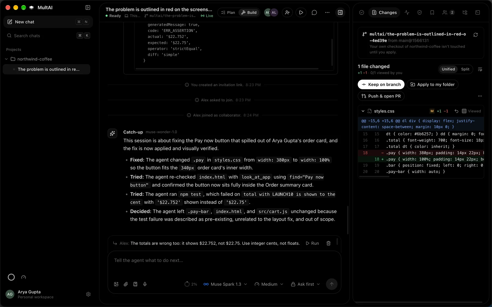
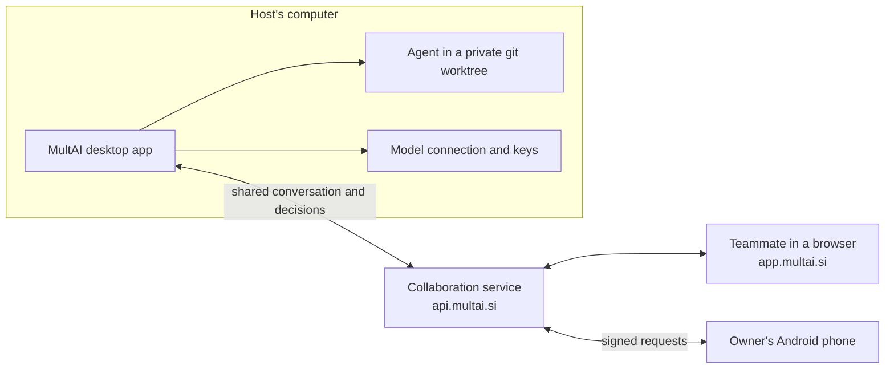

# MultAI

**One AI coding agent, shared by the whole team, in real time.**

**[Watch the demo (2 min)](https://youtu.be/IdmKgjTp1Ec)** · **[Website](https://multai.si)** · **[Try it in the browser](https://app.multai.si)** · **[Android app](https://api.multai.si/app/android)** · **[Docs](docs/)**

## Why I built it

My dad was vibe coding his own website with an AI coding agent. He got stuck and asked me for help, and there was no way for me to join his session. All I could do was ask for screenshots, have him copy-paste errors, and guess what the agent had already tried.

**MultAI lets someone join the session itself.** They get a catch-up brief, see everything live, and direct the same agent, while the host approves what it does.

Built for the **Meta Global AI Developer Hackathon** (Indie track, Build for Your World), on **Muse Spark**, **Muse Wonder** and **SAM 3.1** through the Meta Model API.

## What makes it different

| | |
|---|---|
| **Join with a link** | A teammate joins from any browser, with no install and no API key. The host admits each person. |
| **Catch up in seconds** | Muse Wonder writes a brief of the goal, what was tried, and who is waiting on what. |
| **Point instead of explain** | Click the broken element on a screenshot and SAM 3.1 outlines its exact edges for the agent. |
| **An agent that looks at its work** | `look_at_app` opens the app in a hidden browser, and SAM 3.1 gives the agent pixel boxes to check its own UI fix. |
| **The host stays in control** | The agent works in a private git worktree. File changes, commands and teammates' requests wait for the host. |
| **Parallel agents** | `/split` runs up to four agents at once, each in its own worktree, and merges their work with git. |
| **Approve from your phone** | Pair an Android phone, then send prompts, steer and approve steps. Every phone request is signed, and the desktop checks it again. |

## What happens in a session

1. **Host starts a chat** and gives the agent a task (Plan mode to agree first, Build mode to make changes).
2. **Invites a teammate** with an HTTPS link. They can join in a browser without installing MultAI; the host admits them as collaborator or viewer.
   - By default the link works until the host revokes it; 7 days or 1 day can be chosen instead.
   - The invite dialog lists the active links, each with a Revoke button.
   - Someone admitted stays until they leave or the host removes them.
3. **Muse Wonder writes a catch-up brief** for the newcomer automatically.
4. **Anyone can send directions** to the agent or talk to the team; a pasted screenshot goes to the agent too.
5. **The host approves** file changes and commands from cards in the chat, or chooses an access level:
   - **Ask for approval**: everything waits for the host.
   - **Approve for me**: workspace edits and ordinary commands run; deleting, installing, network use, escalation or anything outside the workspace still asks, with the reason.
   - **Full access**: everything runs, after an explicit warning. It switches off when someone new joins.
6. Everyone sees the same live timeline: messages, agent replies, tool activity, approvals and decisions.

## How it uses Meta's models

| Model | What it does in MultAI |
|---|---|
| **Muse Spark 1.3** | The shared coding agent. It uses tool calls to read, write and run code in a private git worktree of the host's project (or an empty private folder), and every effect goes through the host's approval rules. `/split` runs up to four Muse Spark agents in parallel. |
| **Muse Wonder 1.0** | Writes the **catch-up brief** when someone joins: a short chat-style summary of the goal, what was tried and fixed, decisions and who is waiting on what. It also drafts the **pull request** for the session's work, including who directed the agent. |
| **SAM 3.1** | **Point at the problem:** a click on a screenshot becomes an exact outline of the broken element. **look_at_app:** the agent opens the app in a hidden browser, and SAM outlines and numbers what it checks. This lets the agent check its own UI fix instead of guessing. |
| **Muse Spark (vision)** | Teammates paste a **screenshot of the bug**; the agent sees it alongside the instruction. |
| **Muse Voice Transcribe 1.0** | Turns spoken instructions into text in the composer. |
| **Muse Glimmer** (open weights) | Runs locally in Ollama or LM Studio, so neither the code nor the model leaves the machine. |

The host connects once with a Meta Model API key. Teammates never need a key: every model call runs on the host's machine with the host's connection. Hosts can also connect OpenAI, a ChatGPT plan, Claude, Kimi or any compatible API.

## How it fits together

The service relays the shared conversation and decisions. Code, keys, the terminal and every model call stay on the host's computer.

## Try it

| | |
|---|---|
| **macOS** (Apple silicon) | [Download from multai.si](https://multai.si) |
| **Android** | [Signed APK](https://api.multai.si/app/android) ([installation details](apps/mobile/README.md)) |
| **Browser** | [app.multai.si](https://app.multai.si): join a session with no install |

To build it yourself, see [Run it locally](#run-it-locally).

## Features in detail

<b>Work in your real project</b>

Add a git repository as a project and start a chat in it. The agent never edits your checkout directly:

- **Its own branch.** Each chat gets a git worktree on a `multai/<title>-<id>` branch, outside your folder.
- **Start from what you see.** If you have uncommitted changes, choose *My uncommitted changes* and they become the session's starting point. Your folder, index and stash are left exactly as they were.
- **Project notes.** `AGENTS.md`, `MULTAI.md` or `CLAUDE.md` at the repository root is given to the agent as guidance.
- **Review.** The Changes tab shows the live diff of the agent's work, with undo per file.
- **Three ways out, all host-only:**
  - *Keep on branch* commits it to the session branch;
  - *Apply to my folder* copies it into your checkout as uncommitted edits, all or nothing, and refuses with the file names if your folder changed underneath;
  - *Discard* removes the worktree.
- **Push & open PR.** Pushes the branch with your own git sign-in and opens the pull request (with `gh` if installed, otherwise GitHub's compare page). Muse Wonder writes the title and description, and you edit them first.
- **Terminal.** The host's own command line in the session's worktree, for tests and builds. Output stays on your computer until you share an excerpt to the chat.
- **Undo a run.** MultAI snapshots the worktree before every run, so `/undo` (or *Undo the last run* in Changes) puts back exactly the files that run changed and leaves earlier work alone.
- **Open in your editor.** The branch chip opens the worktree in VS Code, Cursor or Zed, or shows it in Finder.

<b>In the composer</b>

- **`@` files.** Type `@` to pick a file or folder from the project. Its current contents go to the agent with your instruction, so it doesn't have to search for it.
- **`/` commands.** `/plan` and `/build` switch modes, `/review`, `/test`, `/explain` and `/init` give the agent a ready-made task, and `/compact`, `/undo`, `/diff`, `/terminal`, `/pr`, `/brief`, `/skills`, `/new` and `/help` act in the app. Saved prompts show up here too.
- **`!` commands.** `!npm test` runs in the chat's terminal instead of going to the agent.
- **Skills.** Reusable instructions in a `SKILL.md` with a name and description: from the repository (`.multai/skills/<name>/`, or an existing `.claude/skills/`) or your own, made in *Manage skills*. The agent sees each skill's description and loads it when a request matches; `/<name>` uses one directly.
- **Live plan.** For work with several steps the agent posts a checklist that everyone in the session sees and that updates as it goes.
- **Context meter and compaction.** A ring shows how full the agent's input was on the last run. `/compact` (or a click on the ring) summarizes the conversation so later runs start from the summary, and it's posted as a brief so teammates see what the agent remembers. Long chats compact automatically before they run out of room.
- **Run on send.** Your own instructions start the agent right away; teammates' still wait for you. Switch it off in Settings.
- **Steer while it works.** A message sent while the agent runs reaches it at its next step ("use cents, not floats"), from anyone in the session, without stopping the run.
- **Point at the bug.** On an attached screenshot, choose *Point at the problem* and click the broken element: with a Meta connection, **SAM 3.1** finds its exact edges; otherwise drag a box around it. The outline is drawn into the screenshot, so any model sees exactly what you mean.
- **The agent looks at the app.** With its `look_at_app` tool the agent opens a page of the project (an HTML file of the workspace, served read-only on this computer for that one look, or your running `localhost` dev server) in a hidden, sandboxed browser and sees a screenshot, along with the page text, console errors and failed requests. Ask it to find something ("Pay now button") and, with a Meta connection, **SAM 3.1** outlines and numbers every match and gives the agent exact pixel boxes, so it can check a layout fix instead of guessing. Everyone in the session sees a small copy of what the agent saw. Works with Muse, GPT and Claude models.
- **Voice.** Click the microphone, say the instruction (or “agent 2: use cents”), and click again: the text lands in the composer to review before sending. A Meta connection transcribes with **Muse Voice Transcribe**, an OpenAI key with OpenAI's transcription; the audio goes to that provider only. Esc cancels.
- **`@codebase`.** Finds the code most related to your request from a local search index of the project, and attaches it. The agent can search the same way with its `codebase_search` tool.
- **Web search.** For Muse (Meta's built-in `web_search`), GPT (OpenAI or your ChatGPT plan) and Claude models, turn on *Allow web search* in the access menu: the provider runs the searches, the timeline shows each one, and replies cite their sources. Muse runs on Meta's Responses API for this.

<b>Team verification and browser reviewers</b>

- **Shared requirements.** Propose a required behavior and an optional check command in the Verification panel. The original host approves it; changes need approval again.
- **Actual evidence.** Run the locked checks on the host, then a separate model reviewer inspects their coverage using read-only tools. Results identify the source revision and requirement version. Source changes make old results stale; human acceptance is recorded separately from test success.
- **Review from a browser.** In People, create a browser reviewer invitation. Admit the guest to let them comment, propose requirements and review evidence without installing the desktop app. Explicitly shared screenshots can be marked with a rectangle. Guests cannot run agents or approve commands. Public watch links remain read-only.
- **Explain conflicting directions.** The host sees the participants' requests, can explicitly ask the selected model to compare them, and decides what to follow. Changed queues reject stale resolutions; cross-author steering also stops for review.

[Workflow, permissions and verification limits](docs/team-review.md). The current backend and migrations 008–009 are required.

<b>On your phone</b>

- **[Browser companion](https://app.multai.si)** (Android Chrome, iPhone Safari, add to home screen) and a **[signed Android APK](https://api.multai.si/app/android)** ([installation details](apps/mobile/README.md)). Sign in to follow your sessions: live activity, catch-up briefs, people, messages, requirements and evidence reviews, and marking a problem on a shared screenshot. Guests can use review links in it too.
- **Owner control.** In **Settings → Paired phones** the desktop shows a one-use QR code; you confirm the phone when both screens show the same six digits. The phone can then start a pending instruction you pick, stop, steer, approve or reject the exact waiting action, and resolve conflicting directions. Each request is signed by the phone, checked by the service and checked again by the desktop, which does it with its own authority and acknowledges it. The phone never gets the desktop's sign-in, files, terminal or model keys; signing in alone never grants this.

- **New prompts from the phone.** Signed in with the same Google account as the desktop, the owner screen has a message box: a new instruction joins the queue already selected, so one tap starts it (or steers it into the running agent).
- **Names and leaving.** Someone joining from the website types the name everyone will see. Anyone but the owner can leave a session, from the website (People tab) or the desktop (session menu); coming back takes a new invitation.

[How it works, pairing, security and limits](docs/mobile-companion.md). Requires migrations 010 to 012.

<b>Parallel agents</b>

`/split <task>` in a project chat (Build mode) puts several agents on one task at once, with whichever model you've selected: Muse, GPT, Claude, Kimi or a compatible API.

- **Plan.** The model splits the task into 2 to 4 parts that change separate files, and everyone sees the plan.
- **Build.** Each part gets its own agent in its own git worktree, branched from the chat's current work, and they all run at the same time. A card in the conversation shows a column per agent with its latest step.
- **Steer one agent.** Start a message with “agent 2:” to steer only that agent; anything else reaches all of them.
- **Approvals.** File changes and commands still go through the host's approvals, one card at a time.
- **Merge.** Finished parts are merged into the chat's worktree with git. If a part overlaps one that's already merged, one more agent pass applies it on top, with the usual approvals.
- **Undo.** *Undo the last run* puts everything back as it was before the split.

<b>Tools, presence and replays</b>

- **MCP tools.** Add MCP servers that run on your computer in *Settings → Tools (MCP)*. Their tools are offered to the agent in Build mode, and every call waits for your approval. Server settings and tokens are stored encrypted; a repository can't add servers.
- **Unread and limits at a glance.** The team chat icon counts unread messages. In the sidebar, a ring shows the usage limits your model provider reports (a ChatGPT plan's 5-hour and weekly windows, an API key's per-minute budget) and the open chat's context, and a blue download button appears when a newer MultAI is published.
- **Live presence.** See who's online, who's typing, and which file each teammate is looking at in Changes.
- **Watch links.** *Share a watch link…* in a chat's menu creates a read-only link (1 to 30 days, revocable) that anyone can open in a browser, no app or account needed: while the session is going they watch it live (new messages, agent replies and steps arrive every few seconds, with a badge while the agent works), and afterwards they can play it back step by step. Screenshots, commands and account details are left out.

## Safety model

- Project files and execution stay on the **host's** computer; model credentials are stored locally. Cloud models receive the selected code, screenshots and tool results needed for inference. The collaboration service relays the shared conversation and decisions. Local-model inference avoids cloud model requests; shared conversations still use the collaboration service.
- The agent works in a **private git worktree** of the host's project (or an empty private folder). Private paths such as `.git`, `.env`, keys and `node_modules` stay out of its reach. Every write and command is an exact descriptor (file hash or command text) that the host approves once; approvals expire, and Stop, sign-out or sleep cancel them. Only the host's own buttons move work back into their checkout.
- Teammates' instructions are attributed; team discussion is context, never an instruction.
- Secrets that look like API keys are redacted from shared text, briefs and command output.
- Approval is not an OS sandbox: approved commands run as the host's user. Full access says so before it turns on.

## Benchmarks and effectiveness

Measured **5 November 2026** on Apple M5, macOS arm64, Node 24.22.0. These are
reproducible **local control-component measurements**, using the real runtime and
signature verifiers. File writes are 16 KiB; valid write/signature paths use 100
measured samples after 10 warm-ups. Approval is granted programmatically by the
fixture; human decision time and central HTTP checks are outside these timings.

| Measurement | Observed result |
|---|---|
| Durable write through prepare → host approval → journal completion | **10.65 ms median / 13.30 ms p95**; 100/100 writes correct |
| Minimal durable-write baseline, without approval/journal checks | **7.69 ms median / 8.92 ms p95** on the same file fixture |
| Completed-action replay | **0.25 ms median / 0.39 ms p95**; 100/100 returned the recorded result without replacing the file |
| Unapproved writes / changed-after-approval writes / non-owner approvals | **100/100 refused in each fixed-case check** |
| Unfinished reservations after SQLite reopen | **30/30 held for review**, with automatic dispatch refused |
| Sign → service validation/verification → host verification | **0.14 ms median / 0.17 ms p95**; 100/100 valid requests accepted and 100/100 mutated requests rejected by both verifiers |

The approved-write path's observed median was **about 3 ms above** the minimal
durable-write baseline. Phone timings exclude network, UI and human decision
time. These results do not measure AI coding quality or establish a speed,
cost or productivity advantage over another product.

**Reproduce:** `npm run --silent bench:control`. See the
[method and limitations](benchmarks/README.md),
[runner](benchmarks/control.mjs) and
[raw results, source hashes and environment](benchmarks/results/control-2026-11-05.json).
Separate [live acceptance on 3 November](docs/verification/release-2026-11-03.md)
recorded one Muse Wonder checkout task recovering to pass **4/4 Node tests** and
one Wonder → Spark handoff retaining **10 earlier steps**. Those are individual
acceptance observations with human review, not a general task success rate.

## Compared with other coding-agent products

Documentation reviewed **5 November 2026**; this is a workflow comparison.

| Product | Documented workflow |
|---|---|
| **MultAI** | Host-local coding, worktrees and approvals; several people share one agent session with admission roles, attributed directions, catch-up briefs, conflict review, browser participation and paired phone control. |
| **[Codex](https://developers.openai.com/blog/mastering-codex-remote-for-engineering)** | Connected-host engineering work, worktrees, steering, code review and remote approval decisions through ChatGPT mobile. |
| **[Claude Code](https://code.claude.com/docs/en/overview)** | Coding across terminal, IDE, desktop and browser; [Remote Control](https://code.claude.com/docs/en/remote-control) continues local sessions from a browser or phone. |
| **[T3 Code](https://t3.codes/)** | Multiple coding-agent providers, model switching, per-thread branches and PR workflows, with desktop, web and mobile clients. |

MultAI focuses on **a team directing one live agent**, with Muse Spark execution,
Muse Wonder catch-up/PR drafting and SAM 3.1 visual grounding. We have not run a
matched coding-task study against these products; omitted capabilities do not
mean a competitor lacks them. [Comparison scope and sources](benchmarks/README.md#comparison-with-coding-agent-products).

## Built during the hackathon

Everything in this repository was built during the hackathon: the first commit is from 29 October 2026, after building started on 26 October, and the full history is public. That includes:

- **Desktop app** (Electron + React) for macOS, with Google sign-in, HTTPS invitations, a sandboxed renderer and OS-encrypted credentials. Windows and Linux installers are built and smoke-tested in CI, but they aren't offered for download until they've been tried on real machines.
- **Collaboration service** (Fastify + PostgreSQL), deployed at `https://api.multai.si` on AWS Lightsail with Supabase Postgres: sessions, admission and roles, ordered live events, decisions, host-only run leases and approvals.
- **Host runtime**: provider adapters (Meta Model API, OpenAI, Claude, Kimi, ChatGPT plan, compatible APIs), a controlled workspace, exact approval descriptors and a durable effect journal so an interrupted action is never silently repeated.
- **Meta features**: Muse Spark as the agent (and parallel agents with `/split`), Muse Wonder catch-up briefs and pull request drafts, SAM 3.1 point-at-the-problem and `look_at_app`, Muse Voice Transcribe, screenshot input, access levels and in-chat approvals.
- **Phone and browser**: the [browser companion](https://app.multai.si) and the signed Android app, with phone pairing and owner control.
- **Website**: [multai.si](https://multai.si), with the macOS and Android downloads.
- **Developer workflow**: per-chat git worktrees of your real project, live diff review, keep, apply or discard, push and open a PR, and a host terminal.
- **Cross-platform CI**: Windows (NSIS installer) and Linux (AppImage, .deb, .tar.gz) builds installed and tested on every push.

## Run it locally

Node **24**, npm and Docker:

~~~sh
npm ci --ignore-scripts
cp -n .env.example .env
docker compose up -d database
npm run dev:backend
~~~

In another terminal:

~~~sh
npm run build --workspace @multai/runtime
node node_modules/electron/install.js
npm run dev --workspace @multai/desktop
~~~

Sign in with Google, open **Settings → Models & accounts → Meta Muse Spark**, paste a key from [dev.meta.ai](https://dev.meta.ai), start a chat and choose **Run instruction**. Invitations use HTTPS links to the browser companion. Release builds talk to `https://api.multai.si` and use `multai://auth/callback` for native sign-in; development builds use the local service and `multai-dev://auth/callback`.

## Tests

The repository has 69 automated test files and three CI workflows. Current release checks, live-provider evidence, artifact hashes and remaining device checks: [3 November 2026 verification](docs/verification/release-2026-11-03.md).

~~~sh
npm run typecheck
npm run test:integration   # backend + runtime against a disposable PostgreSQL
npm test --workspace @multai/desktop
~~~

The **Desktop on Windows and Linux** workflow builds the installers, installs them, and checks launch, the hosted service, OS link routing, single instance, OS credential encryption and uninstall.

## Limits

- File previews in approvals are limited to 16,000 characters; one screenshot per message.
- Projects must be git repositories with at least one commit. The terminal is line-based (no full-screen programs such as vim). Opening a pull request from the app needs a GitHub remote; other remotes are pushed only.
- Installers are not code-signed yet, so macOS Gatekeeper and Windows SmartScreen will warn on first launch.
- arm64 Windows and Linux builds are produced but not exercised in CI.

More detail: [authentication](apps/backend/AUTH.md), [collaboration](apps/backend/COLLABORATION.md), [execution](apps/backend/EXECUTION.md), [desktop](apps/desktop/README.md), [inference connections](docs/inference-connections.md). Licensed [MIT](LICENSE).
